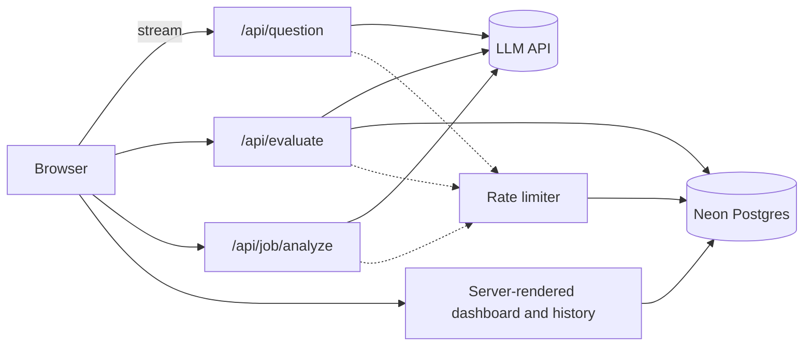

# InterviewPrep: AI Mock Interview Trainer

Practice interviews with AI-generated questions, rubric-based scoring, voice input and progress tracking. Try it without signing in.

**Live demo:** <your-live-url>

<!-- Add screenshots: docs/home.png, docs/feedback.png, docs/dashboard.png -->

## Features

- **Role-based questions** streamed word by word, at junior, mid or senior level
- **Job-posting mode**: paste a real job description and get questions tailored to its skills and responsibilities
- **Structured scoring** on four dimensions (structure, clarity, relevance, depth) with reasoning, strengths, improvements and a stronger rewrite of your answer
- **Voice dictation** using the Web Speech API, with speaking pace and filler-word stats
- **Progress dashboard**: score trend, per-dimension averages, weakest-area tips, per-role breakdown
- **Session history** with the ability to reopen or delete any session
- **Works anonymously**; signing in with GitHub saves your progress

## Tech stack

| Area | Choice |
|---|---|
| Framework | Next.js (App Router), React, TypeScript |
| Styling | Tailwind CSS |
| LLM | Any OpenAI-compatible API (Groq with `openai/gpt-oss-120b` by default) |
| Database | Postgres on Neon, queried with Drizzle ORM |
| Auth | Auth.js (GitHub OAuth, JWT sessions) |
| Charts | Recharts |
| Validation | Zod |
| Hosting | Vercel |

## Architecture



## Design decisions

- **Consistent scoring.** A fixed rubric with written score anchors, low temperature, JSON output validated with Zod, and one retry on malformed output. The overall score is computed in code, never by the model.
- **Prompt-injection resistance.** Answers and job postings are wrapped in tags and treated as data. Extracted job fields are sanitised and length-capped before they are reused in later prompts.
- **Nothing sensitive is stored needlessly.** Job postings are analysed once and never saved; only a short label such as "Frontend Developer at Acme" is kept.
- **Atomic writes.** A new session and its first answer are created in one batch, so there are no empty sessions.
- **Ownership checks everywhere.** Every query filters by the signed-in user, and session ids from the client are verified before use.
- **Scores survive save failures.** If the database write fails, the feedback is still returned.
- **Rate limiting without extra services.** Counters live in Postgres with an atomic upsert, with higher limits for signed-in users and a global daily cap.
- **Progressive enhancement.** Voice input appears only in browsers that support speech recognition.

## Getting started

```bash
git clone https://github.com/Sudesh-2002/mock-interview-trainer.git
cd mock-interview-trainer
npm install
cp .env.example .env.local   # then fill in the values
npm run db:migrate
npm run dev
```

Open http://localhost:3000.

### Environment variables

| Variable | Purpose |
|---|---|
| `LLM_API_KEY` | API key for the LLM provider |
| `LLM_BASE_URL` | OpenAI-compatible base URL |
| `LLM_MODEL` | Model id, for example `openai/gpt-oss-120b` |
| `DATABASE_URL` | Neon pooled Postgres connection string |
| `AUTH_SECRET` | Random secret for Auth.js (`npx auth secret`) |
| `AUTH_GITHUB_ID` / `AUTH_GITHUB_SECRET` | GitHub OAuth app credentials |
| `NEXT_PUBLIC_SITE_URL` | Optional: canonical URL when using a custom domain |

For local sign-in, create a GitHub OAuth app with the callback URL `http://localhost:3000/api/auth/callback/github`.

### Scripts

| Command | What it does |
|---|---|
| `npm run dev` | Start the dev server |
| `npm run build` | Production build |
| `npm run lint` | Run ESLint |
| `npm run db:generate` | Generate a migration from `schema.ts` |
| `npm run db:migrate` | Apply migrations |
| `npm run db:studio` | Open Drizzle Studio |

## Project structure

```
src/
  app/            routes, API handlers, pages
  components/     UI (interview, dashboard, layout)
  db/             Drizzle schema and client
  hooks/          streaming, evaluation and speech hooks
  lib/            prompts, rubric, scoring, queries, rate limiting
```

## Limitations and future work

- Speech recognition depends on the browser (best in Chrome and Edge) and uses the browser's speech service
- No automated tests yet
- No Content-Security-Policy header (needs nonce handling with Next.js)
- Speaking stats are shown after scoring but not yet saved to the database